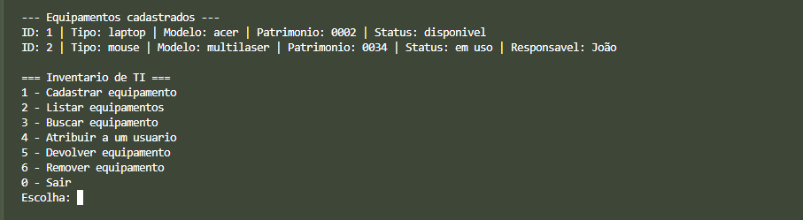

# Inventário de TI

Programa em C++ para o terminal que controla equipamentos de TI de uma empresa (laptops, impressoras, monitores...), com cadastro, busca, atribuição a usuários e armazenamento em arquivo.

## Funcionalidades

- Cadastrar equipamentos (ID, tipo, modelo, número de patrimônio)
- Listar e buscar por ID, tipo ou modelo
- Atribuir um equipamento a um usuário e registrar a devolução
- Remover equipamentos, com confirmação
- Salvar os dados em arquivo, para não perdê-los ao fechar o programa
- Validação de entradas (ID repetido, equipamento já em uso)

## Como baixar e rodar

1. Baixe o projeto:

        git clone https://github.com/lucorde/inventario-ti.git
        cd inventario-ti

2. Compile (requer g++):

        g++ main.cpp -o inventario

3. Execute:

        ./inventario

No Windows (PowerShell), use `.\inventario`.

Sem compilador instalado? Cole o conteúdo de `main.cpp` em um compilador online, como o onlinegdb.com, e clique em Run. Nesse caso os dados podem não ser salvos entre execuções.

## Demonstração

## Exemplo de uso

    === Inventario de TI ===
    1 - Cadastrar equipamento
    2 - Listar equipamentos
    3 - Buscar equipamento
    4 - Atribuir a um usuario
    5 - Devolver equipamento
    6 - Remover equipamento
    0 - Sair

## O que usei

- C++ (structs, vector, ponteiros, funções)
- Leitura e escrita de arquivos com fstream
- Tratamento de entrada do usuário com validação

## Próximos passos

- Gerar o ID automaticamente
- Histórico de quem já usou cada equipamento
- Relatório por status
- Trocar o arquivo de texto por SQLite

## Autor

Lucas Marques Cordeiro